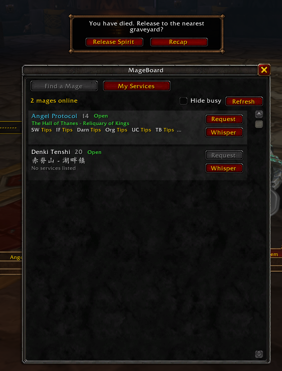
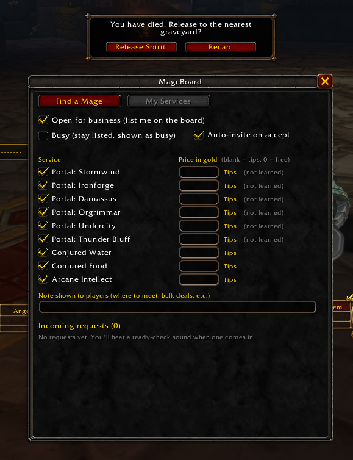
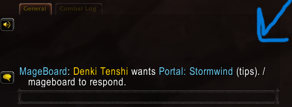

# Mage Dash

**A marketplace for mage and warlock services in WoW: Forever.** Mages put up their portals, food, water and buffs, and warlocks their summons, each with their own rates. Players see who's online, where they are and what they charge, then send a request with one click.

No more spamming "WTB portal SW" in trade chat and hoping.

## Screenshots

| Find a Mage | My Services |
|---|---|
|  |  |

A request arriving in chat:

## Install
1. Download `MageDash-1.1.0.zip` from the [Releases page](https://github.com/yurikoeth/MageBoard/releases).
2. Unzip it into `World of Warcraft\_forever_\Interface\AddOns\` so the folder sits at `AddOns\MageDash`.
3. Restart the game or `/reload`.

## For players
- Open the board with `/mage` (or from the addon compartment on the minimap).
- **Find Services** lists every mage and warlock currently open for business: their level, zone, services and prices, plus any note they've left (where to meet, bulk deals).
- Filter the list to one service, and sort it by nearest, cheapest, highest rank, highest level or name. Mages in your zone are highlighted.
- Water, food and Arcane Intellect show the mage's highest rank. When you request one, you pick the rank, and the best one for your level is marked.
- Hit **Request**, pick a service, and the mage gets your request straight away. When they accept you get an alert with where they are, and a group invite.

## For mages and warlocks
- Go to **My Services** and tick **Open for business**.
- Services you can already cast are ticked for you. Turn any of them on or off. Spells you haven't learned yet are greyed out until you learn them.
- Set a price per service in gold: `5` = 5g, `0.5` = 50s, `0` = free. Leave it blank for **tips**.
- Add a short note ("Mage Quarter fountain, 10% off water stacks").
- Requests show up with a ready-check sound. **Accept** sends the player your location and invites them to your group. **Decline** tells them politely.
- Mark yourself **Busy** to stay listed without implying you're free right now.

## Services
**Mage:** portals to Stormwind, Ironforge, Darnassus, Orgrimmar, Undercity and Thunder Bluff · Conjured Water · Conjured Food · Arcane Intellect

**Warlock:** Summon (Ritual of Summoning). You're summoned to wherever the warlock is standing, which the board shows.

## Commands
| Command | What it does |
|---|---|
| `/mage` | Show or hide the board |
| `/mage find` | Refresh and browse mages |
| `/mage open` / `close` | List or unlist yourself |
| `/mage busy` | Toggle busy |
| `/mage sound` | Toggle the request sound |
| `/mage unlock` | Allow ticking a service shown as not learned |

## Good to know
- **Formerly MageBoard.** Renamed to Mage Dash in 1.1.0. It still works with players on the old version. If you installed MageBoard by hand, delete the old `AddOns\MageBoard` folder.
- **Both sides need Mage Dash.** It talks over a hidden addon channel , so only players running the addon can see each other. The more people install it, the better it gets.
- The channel takes one of your 10 chat channel slots. It's removed from your chat windows automatically, so it won't spam you.
- Each realm and each faction has its own board: you only see mages on your own realm and faction.
- Listings show who's online right now. A mage drops off the board a few minutes after they close, log off or stop sending updates.
- **No gold changes hands through the addon.** Payment happens through the normal trade window.
- Built for WoW: Forever (interface 16001). Also loads on Retail.
- **Status:** new. Tested in-game between two players on WoW: Forever. Bug reports welcome in [Issues](https://github.com/yurikoeth/MageBoard/issues).

## Feedback
Found a bug? Open an issue with the Lua error text (BugSack makes this easy) and what you were doing at the time.

## License
All rights reserved. © yurikoeth
